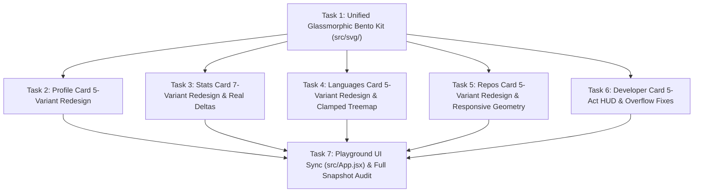

# Premium SVG Cards Master Redesign Implementation Plan

> **For agentic workers:** REQUIRED SUB-SKILL: Use `superpowers:subagent-driven-development` (recommended) or `superpowers:executing-plans` to implement this plan task-by-task. Steps use checkbox (`- [ ]`) syntax for tracking.
>
> **Loaded Skills Report:**
> - `CLAUDE.md` (Startup Router)
> - `tooling/skills/REGISTRY.md` (Skill Registry Index)
> - `tooling/skills/shared/karpathy-coding-principles.md` (Baseline Engineering Discipline)
> - `tooling/skills/workflow/superpowers-brainstorming.md` → `tooling/sources/github/superpowers/skills/brainstorming/SKILL.md`
> - `tooling/skills/workflow/superpowers-writing-plans.md` → `tooling/sources/github/superpowers/skills/writing-plans/SKILL.md`

---

## Goal Description

Elevate all **5 GitHub README SVG cards** (`profile`, `stats`, `languages`, `repos`, `developer`) and their **23 total variants** to a cohesive, studio-grade **"Obsidian Glass & Precision Telemetry"** design system while fixing every layout collision, hardcoded fake metric, overflow bug, and responsive breakpoint defect uncovered during the codebase audit.

## Architecture & Design Decisions (Locked In by Planner)

1. **Unified Glassmorphic Bento Design System (`src/svg/primitives.js` & `src/svg/header.js`)**:
   - Previously, `profile` had its own private `renderPremiumDefs` / `renderGlassFrame` / `renderBentoBox` helpers while `stats`, `languages`, and `repos` rendered flat 2020-era `<rect>` boxes with raw OS emojis.
   - **Decision**: Promote a unified, theme-aware **Glassmorphic Bento Kit** in `src/svg/primitives.js` (`renderCardFrame`, `renderBentoTile`, `renderStatusBadge`, `renderRankBadge`) and upgrade `src/svg/header.js` (`renderCardHeader`) to use vector micro-icons, specular pill rims, and tabular monospace badges while preserving backwards-compatible CSS classes (`card-header-title`).
2. **Typography & Visual Hierarchy**:
   - **UI Sans (`font-ui`)**: `-apple-system, BlinkMacSystemFont, 'Inter', 'Segoe UI', Roboto, sans-serif` for titles, names, and descriptions.
   - **Tabular Telemetry Mono (`font-mono`)**: `'JetBrains Mono', 'SFMono-Regular', Menlo, Consolas, monospace` with `font-variant-numeric: tabular-nums` for all numeric counts, percentages, commit SHAs, streaks, and rank scores.
   - **Micro-Labels (`stat-lbl`)**: `9px`–`9.5px`, `font-weight: 700`, `letter-spacing: 0.08em`, `text-transform: uppercase`, `fill: theme.secondaryText`.
3. **Elimination of Raw Emoji Baseline Jitter & Fake Hardcoded Metrics**:
   - Replace raw medal/folder/clock emojis in data rows with custom SVG geometric badges (`renderRankBadge`) and vector icons (`src/svg/icons.js`).
   - Replace hardcoded fake YoY deltas in `stats` (`ring` had hardcoded `+12%`, `+8%`, `+15%`, `+24%` for every user) and hardcoded `"LEVEL 4 CREST"` in `stats` (`crest`) with **real mathematical derivations** from the user's normalized telemetry.
4. **Strict Backwards-Compatibility with Existing Test Suite**:
   - Every existing test in `tests/*.test.js` (including XML validity via `xmllint --noout`, class names like `bio-text`, `progress-ring`, `stacked-bar`, `radar-chart`, `monthly-bars`, `trajectory-bar`, `metric-tile`, `heatmap-matrix`, `treemap-cell`, `language-bar`, `sparkline`, `stars-bar`, `delta-chip`, and sub-100KB budget for `developer`) MUST continue to pass without regression.



---

## Global Constraints

- **Pure Standalone SVG/SMIL**: Zero external fonts, zero external images (avatars must be base64 data URIs or vector initials), zero `<script>` tags, 100% GitHub Camo proxy compatible.
- **XML Strictness**: Every `&`, `<`, `>`, `"`, `'` in dynamic text or attributes must be escaped via `escapeXml()`. All generated SVGs must pass `xmllint --noout -`.
- **Canonical Width Responsiveness**: Every card variant (except fixed-canvas `developer`) must render without text or box overflow at `width=405` (`half`), `width=495` (`legacy` default), and `width=830` (`full`).
- **Size Budget**: `developer` SVG output must remain strictly `< 100 KB` (`102,400` bytes).
- **Verification**: Run `npm test`, `npm run lint`, and `npm run build` after each task.

---

## Proposed Changes & Step-by-Step Tasks

---

### Task 1: Upgrade Shared Glassmorphic Bento Primitives & Header Kit

**Audit Issues Resolved:**
- `src/svg/primitives.js` had unused `bentoTile` and `svgCanvas` with hardcoded dark colors (`#06080f`, `#090d16`) that broke light themes (`themes.light`).
- `src/cards/profile/index.js` duplicated `renderPremiumDefs`, `renderGlassFrame`, and `renderBentoBox` locally instead of sharing them with `stats`, `languages`, and `repos`.
- `src/svg/header.js` used a flat `<rect>` badge without a specular border or subtitle support, and collided with long titles on `width=405`.

**Files:**
- Modify: `src/svg/primitives.js`
- Modify: `src/svg/header.js`
- Modify: `src/svg/icons.js`
- Test: `tests/phase2-component-kit.test.js`

**Interfaces:**
- Produces in `src/svg/primitives.js`:
  - `renderCardDefs(idPrefix, theme, primaryColor, secondaryColor)` -> `<defs>` content string with theme-aware surface gradients, specular rim gradients, ambient corner radial glows, and dot-matrix pattern.
  - `renderCardStyles(theme, extraCss = '')` -> `<style>` content string defining `.font-ui`, `.font-mono`, `.stat-lbl`, `.stat-val`, `.meta-text`, `.card-header-title`, and pulse animations.
  - `renderCardFrame(width, height, idPrefix, theme, rx = 14)` -> outer glassmorphic card background, dot matrix, corner glows, top accent laser line, and specular rim border.
  - `renderBentoTile({ x, y, width, height, theme, idPrefix, rx = 8, accentColor = null, children = '', className = '' })` -> inset bento container with top-edge specular highlight, optional colored left/top accent bar, and inner content.
  - `renderRankBadge({ x = 0, y = 0, rank = 1, width = 38, height = 20, theme = {} })` -> metallic vector rank pill (`#1` Gold, `#2` Silver, `#3` Bronze, `#4+` Slate) replacing raw emoji medals.
- Produces in `src/svg/header.js`:
  - `renderCardHeader({ title, subtitle = null, badgeText = null, width = 495, theme })` -> fits title safely against badge width using `fitText`, renders optional monospace kicker/subtitle, and renders a glassmorphic pill badge on the right.

- [ ] **Step 1: Add unit tests for the upgraded shared primitives in `tests/phase2-component-kit.test.js`**

Append the following test cases to `tests/phase2-component-kit.test.js`:

```javascript
import {
  renderCardDefs,
  renderCardStyles,
  renderCardFrame,
  renderBentoTile,
  renderRankBadge,
} from '../src/svg/primitives.js';

test('Shared Glassmorphic Bento Kit renders valid XML in both dark and light themes', () => {
  const defs = renderCardDefs('test-card', themes.light, '#0366d6', '#28a745');
  const style = renderCardStyles(themes.light);
  const frame = renderCardFrame(495, 220, 'test-card', themes.light);
  const tile = renderBentoTile({
    x: 24,
    y: 50,
    width: 200,
    height: 60,
    theme: themes.light,
    idPrefix: 'test-card',
    accentColor: '#0366d6',
    children: '<text x="12" y="20">Content</text>',
  });
  const badge = renderRankBadge({ x: 0, y: 0, rank: 1, theme: themes.light });

  const fullSvg = `<svg xmlns="http://www.w3.org/2000/svg" width="495" height="220"><defs>${defs}</defs><style>${style}</style>${frame}${tile}${badge}</svg>`;
  assertValidXml(fullSvg);
  assert.ok(fullSvg.includes('test-card-bg'));
  assert.ok(fullSvg.includes('#1'));
});
```

- [ ] **Step 2: Run test to verify it fails**

Run: `node --test tests/phase2-component-kit.test.js`
Expected: FAIL (`renderCardDefs` is not exported from `src/svg/primitives.js`).

- [ ] **Step 3: Implement the new icons in `src/svg/icons.js`, header in `src/svg/header.js`, and Bento primitives in `src/svg/primitives.js`**

1. In `src/svg/icons.js`, add `trophy`, `sparkles`, `layers`, `clock`, `shield`, and `trendUp` vector icons alongside the existing icons:

```javascript
  trophy: (color = '#eab308') => `
    <svg class="icon" viewBox="0 0 16 16" width="13" height="13" fill="${color}" style="display:inline-block;vertical-align:text-top;">
      <path d="M4.5 1a.5.5 0 00-.5.5V2H1.75a.75.75 0 00-.75.75v1.5A3.75 3.75 0 004.22 7.97a4.01 4.01 0 003.03 2.48V13H4.75a.75.75 0 000 1.5h6.5a.75.75 0 000-1.5H8.75v-2.55a4.01 4.01 0 003.03-2.48A3.75 3.75 0 0015 4.25v-1.5A.75.75 0 0014.25 2H12v-.5a.5.5 0 00-.5-.5h-7zM2.5 3.5H4v2.72A2.25 2.25 0 012.5 4.25v-.75zm9.5 2.72V3.5h1.5v.75a2.25 2.25 0 01-1.5 1.97z"></path>
    </svg>`,

  clock: (color = 'currentColor') => `
    <svg class="icon" viewBox="0 0 16 16" width="12" height="12" fill="${color}" style="display:inline-block;vertical-align:text-top;">
      <path fill-rule="evenodd" d="M8 1.5a6.5 6.5 0 100 13 6.5 6.5 0 000-13zM0 8a8 8 0 1116 0A8 8 0 010 8zm9 3a1 1 0 11-2 0 1 1 0 012 0zm-.25-6.25a.75.75 0 00-1.5 0v3.5a.75.75 0 00.471.696l2.5 1a.75.75 0 00.557-1.392L8.75 7.742V4.75z"></path>
    </svg>`,

  layers: (color = 'currentColor') => `
    <svg class="icon" viewBox="0 0 16 16" width="13" height="13" fill="${color}" style="display:inline-block;vertical-align:text-top;">
      <path d="M8 .5L.5 4.25 8 8l7.5-3.75L8 .5zM.5 8L8 11.75 15.5 8M.5 11.75L8 15.5l7.5-3.75" stroke="${color}" stroke-width="1.4" fill="none" stroke-linecap="round" stroke-linejoin="round"></path>
    </svg>`,
```

2. In `src/svg/header.js`, update `renderCardHeader` so it safely fits the title when `width` is narrow (`405px`), adds a crisp glassmorphic pill border on the badge, and preserves `class="card-header-title"`:

```javascript
import { escapeXml } from './escape.js';
import { fitText, measureText } from './text.js';

/**
 * Standardized SVG header component for cards.
 * @param {object} params
 * @param {string} params.title - Card title text
 * @param {string} [params.badgeText] - Optional badge / pill text on the right
 * @param {number} [params.width=495] - Total width of the card
 * @param {object} params.theme - Card theme palette
 * @returns {string} SVG <g> element containing header title and optional pill badge
 */
export function renderCardHeader({ title, badgeText, width = 495, theme = {} }) {
  const rawBadge = badgeText ? String(badgeText) : null;
  const badge = rawBadge ? escapeXml(rawBadge) : null;
  const badgeW = rawBadge ? Math.max(88, Math.ceil(measureText(rawBadge, 10) + 24)) : 0;
  const innerWidth = width - 48;
  const badgeX = innerWidth - badgeW;
  const maxTitleWidth = rawBadge ? Math.max(140, badgeX - 14) : innerWidth;
  const titleText = escapeXml(fitText(String(title || ''), 16.5, maxTitleWidth));
  const accent = theme.accent || theme.title || '#58a6ff';

  return `
    <g transform="translate(24, 24)">
      <rect x="0" y="-12" width="3" height="15" rx="1.5" fill="${accent}" />
      <text x="10" y="0" class="card-header-title" font-family="-apple-system, BlinkMacSystemFont, 'Inter', 'Segoe UI', Roboto, sans-serif" font-weight="800" font-size="16.5" letter-spacing="-0.02em" fill="${theme.title}">${titleText}</text>
      ${badge ? `
        <rect x="${badgeX}" y="-14" width="${badgeW}" height="20" rx="10" fill="${theme.badgeBg}" stroke="${theme.subtleBorder || theme.border}" stroke-width="1"/>
        <text x="${badgeX + badgeW / 2}" y="-0.5" text-anchor="middle" font-family="'JetBrains Mono', 'SFMono-Regular', Consolas, monospace" font-weight="700" font-size="9.5" fill="${theme.title}">${badge}</text>
      ` : ''}
    </g>`;
}
```

3. In `src/svg/primitives.js`:
   - Enhance `renderProgressRing` with an outer degree tick ring (`stroke-dasharray="2 4"`), subtle glow ring, and crisp tabular score subtitle.
   - Enhance `renderStackedBar` with a top-edge specular gloss line (`<line x1="0" y1="0.75" x2="${width}" y2="0.75" stroke="#ffffff" stroke-opacity="0.22" stroke-width="1"/>`).
   - Enhance `renderCommitSparkline` to include an illuminated endpoint dot (`<circle cx="${lastX}" cy="${lastY}" r="2.5" fill="${strokeColor}" />`) on the latest data point.
   - Add `renderCardDefs`, `renderCardStyles`, `renderCardFrame`, `renderBentoTile`, and `renderRankBadge`:

```javascript
/**
 * 13. Theme-Aware Glassmorphic Card Defs
 */
export function renderCardDefs(idPrefix, theme = {}, primaryColor = null, secondaryColor = null) {
  const c1 = primaryColor || theme.title || '#38bdf8';
  const c2 = secondaryColor || theme.accent || '#818cf8';
  const isLight = theme.bg === '#ffffff' || (theme.bg && String(theme.bg).toLowerCase().includes('fff'));
  const rimHighlight = isLight ? theme.border || '#d0d7de' : '#ffffff';
  const rimOpacity = isLight ? '0.85' : '0.22';
  const dotOpacity = isLight ? '0.18' : '0.12';

  return `
    <linearGradient id="${idPrefix}-bg" x1="0%" y1="0%" x2="100%" y2="100%">
      <stop offset="0%" stop-color="${theme.bg}" />
      <stop offset="100%" stop-color="${theme.cardBg}" />
    </linearGradient>
    <linearGradient id="${idPrefix}-rim" x1="0%" y1="0%" x2="100%" y2="100%">
      <stop offset="0%" stop-color="${rimHighlight}" stop-opacity="${rimOpacity}" />
      <stop offset="45%" stop-color="${theme.border}" stop-opacity="0.65" />
      <stop offset="100%" stop-color="${c1}" stop-opacity="0.35" />
    </linearGradient>
    <linearGradient id="${idPrefix}-tile-rim" x1="0%" y1="0%" x2="0%" y2="100%">
      <stop offset="0%" stop-color="${rimHighlight}" stop-opacity="${isLight ? '0.6' : '0.14'}" />
      <stop offset="100%" stop-color="${theme.subtleBorder || theme.border}" stop-opacity="0.45" />
    </linearGradient>
    <linearGradient id="${idPrefix}-brand" x1="0%" y1="0%" x2="100%" y2="0%">
      <stop offset="0%" stop-color="${c1}" />
      <stop offset="100%" stop-color="${c2}" />
    </linearGradient>
    <radialGradient id="${idPrefix}-glow-tl" cx="0%" cy="0%" r="65%">
      <stop offset="0%" stop-color="${c1}" stop-opacity="${isLight ? '0.07' : '0.14'}" />
      <stop offset="100%" stop-color="${c1}" stop-opacity="0" />
    </radialGradient>
    <radialGradient id="${idPrefix}-glow-br" cx="100%" cy="100%" r="65%">
      <stop offset="0%" stop-color="${c2}" stop-opacity="${isLight ? '0.06' : '0.11'}" />
      <stop offset="100%" stop-color="${c2}" stop-opacity="0" />
    </radialGradient>
    <pattern id="${idPrefix}-dots" width="18" height="18" patternUnits="userSpaceOnUse">
      <circle cx="2" cy="2" r="0.8" fill="${theme.secondaryText}" fill-opacity="${dotOpacity}" />
    </pattern>
  `;
}

/**
 * 14. Standardized Card Typography & Utility CSS
 */
export function renderCardStyles(theme = {}, extraCss = '') {
  return `
    .font-ui { font-family: -apple-system, BlinkMacSystemFont, 'Inter', 'Segoe UI', Roboto, sans-serif; }
    .font-mono { font-family: 'JetBrains Mono', 'SFMono-Regular', Menlo, Consolas, monospace; font-variant-numeric: tabular-nums; }
    .stat-lbl { font-family: -apple-system, BlinkMacSystemFont, 'Inter', 'Segoe UI', sans-serif; font-weight: 700; font-size: 9px; fill: ${theme.secondaryText}; letter-spacing: 0.08em; text-transform: uppercase; }
    .stat-val { font-family: 'JetBrains Mono', 'SFMono-Regular', Menlo, Consolas, monospace; font-weight: 800; font-size: 14px; fill: ${theme.title}; font-variant-numeric: tabular-nums; }
    .meta-text { font-family: -apple-system, BlinkMacSystemFont, 'Inter', 'Segoe UI', sans-serif; font-size: 10.5px; font-weight: 500; fill: ${theme.secondaryText}; }
    @keyframes statusPulse { 0%, 100% { opacity: 0.45; } 50% { opacity: 1; } }
    .pulse-dot { animation: statusPulse 2.2s ease-in-out infinite; }
    ${extraCss}
  `;
}

/**
 * 15. Outer Glassmorphic Card Frame with Top Specular Accent Bar
 */
export function renderCardFrame(width, height, idPrefix, theme = {}, rx = 14) {
  const isTransparent = theme.bg === 'transparent';
  return `
    ${!isTransparent ? `<rect x="0.5" y="0.5" rx="${rx}" width="${width - 1}" height="${height - 1}" fill="url(#${idPrefix}-bg)" />` : ''}
    <rect x="0.5" y="0.5" rx="${rx}" width="${width - 1}" height="${height - 1}" fill="url(#${idPrefix}-dots)" />
    <rect x="0.5" y="0.5" rx="${rx}" width="${width - 1}" height="${height - 1}" fill="url(#${idPrefix}-glow-tl)" />
    <rect x="0.5" y="0.5" rx="${rx}" width="${width - 1}" height="${height - 1}" fill="url(#${idPrefix}-glow-br)" />
    <path d="M ${rx + 4},0.5 L ${width - rx - 4},0.5" stroke="url(#${idPrefix}-brand)" stroke-width="2" stroke-linecap="round" opacity="0.85" />
    <rect x="0.5" y="0.5" rx="${rx}" width="${width - 1}" height="${height - 1}" fill="none" stroke="url(#${idPrefix}-rim)" stroke-width="1" />
  `;
}

/**
 * 16. Glassmorphic Bento Tile Container
 */
export function renderBentoTile({
  x = 0,
  y = 0,
  width = 120,
  height = 54,
  theme = {},
  idPrefix = 'card',
  rx = 8,
  accentColor = null,
  accentPosition = 'left',
  className = '',
  children = '',
}) {
  const isLight = theme.bg === '#ffffff' || (theme.bg && String(theme.bg).toLowerCase().includes('fff'));
  const fillOpacity = isLight ? '0.92' : '0.78';
  const specOpacity = isLight ? '0.5' : '0.15';
  const clsAttr = className ? ` class="${className}"` : '';

  let accentSvg = '';
  if (accentColor) {
    if (accentPosition === 'top') {
      accentSvg = `<rect x="0" y="0" width="${width}" height="3.5" rx="1.75" fill="${accentColor}" />`;
    } else {
      accentSvg = `<rect x="0" y="0" width="3.5" height="${height}" rx="1.75" fill="${accentColor}" />`;
    }
  }

  return `
    <g${clsAttr} transform="translate(${x}, ${y})">
      <rect x="0" y="0" width="${width}" height="${height}" rx="${rx}" fill="${theme.cardBg}" fill-opacity="${fillOpacity}" stroke="url(#${idPrefix}-tile-rim)" stroke-width="1" />
      <line x1="${rx}" y1="0.5" x2="${width - rx}" y2="0.5" stroke="#ffffff" stroke-opacity="${specOpacity}" stroke-width="1" />
      ${accentSvg}
      ${children}
    </g>
  `;
}

/**
 * 17. Metallic / Glass Rank Standing Badge (#1 Gold, #2 Silver, #3 Bronze, #4+ Slate)
 */
export function renderRankBadge({ x = 0, y = 0, rank = 1, width = 38, height = 18, theme = {} }) {
  const tierStyles = {
    1: { bg: 'rgba(234, 179, 8, 0.18)', border: '#eab308', text: '#eab308', label: '#1 🥇' },
    2: { bg: 'rgba(148, 163, 184, 0.18)', border: '#94a3b8', text: '#94a3b8', label: '#2 🥈' },
    3: { bg: 'rgba(217, 119, 6, 0.18)', border: '#d97706', text: '#d97706', label: '#3 🥉' },
  };
  const st = tierStyles[rank] || {
    bg: theme.badgeBg || 'rgba(139, 148, 158, 0.12)',
    border: theme.subtleBorder || theme.border || '#30363d',
    text: theme.secondaryText || '#8b949e',
    label: `#${rank}`,
  };

  return `
    <g class="rank-badge" transform="translate(${x}, ${y})">
      <rect x="0" y="0" width="${width}" height="${height}" rx="${Math.round(height / 2)}" fill="${st.bg}" stroke="${st.border}" stroke-opacity="0.6" stroke-width="1" />
      <text x="${width / 2}" y="${Math.round(height * 0.68)}" text-anchor="middle" font-family="'JetBrains Mono', 'SFMono-Regular', monospace" font-size="9.5" font-weight="800" fill="${st.text}">${escapeXml(st.label)}</text>
    </g>
  `;
}
```

- [ ] **Step 4: Run test to verify it passes**

Run: `node --test tests/phase2-component-kit.test.js && node --test tests/unified-header.test.js`
Expected: PASS

- [ ] **Step 5: Commit Task 1**

```bash
git add src/svg/icons.js src/svg/header.js src/svg/primitives.js tests/phase2-component-kit.test.js
git commit -m "feat(svg): add unified glassmorphic bento primitives and responsive header"
```

---

### Task 2: Redesign `profile` Card Across All 5 Variants (`src/cards/profile/index.js`)

**Audit Issues Resolved:**
1. **`classic` Variant**:
   - Eliminated duplicate name (`renderCardHeader` had `${p.name} // Identity` directly above `<text>${p.name}</text>`). Header now reads `DEVELOPER PROFILE // IDENTITY` with badge `🟢 Available for hire` or `Joined ${year} · ${age}y active`.
   - Fixed `@handle` collision by computing exact pixel offset `measureText(fittedName, 18) + 10` instead of `p.name.length * 10`.
   - Replaced hardcoded `x=135, 265` metadata offsets (which overflowed on `405px` and collided on long company names) with dynamic pill capsules (`company`, `location`, `website`, or live status) that measure and advance `currentX` cleanly within `contentWidth - 76`.
   - Closed the 50px dead vertical gap and upgraded the 4-cell Bento footer strip (`TOP LANGUAGE`, `FLAGSHIP REPO` with `★ stars` count, `COMMUNITY` followers/stars, `TENURE` `Joined YYYY · Ny active`).
2. **`hero` Variant**:
   - Fixed the banner corner gap bug by clipping the top 56px aurora banner cleanly to the card's rounded top corners using a `<clipPath>` and overlaying an architectural grid mesh.
   - Replaced raw `🏢` emoji with vector `icons.company(theme.iconColor)` inside the organization pills.
   - Shortened the first metric label from `REPOSITORIES` (which overflowed 106px tiles) to `PUBLIC REPOS` and centered/aligned the icon + label + tabular value cleanly across all widths (`405`, `495`, `830`).
3. **`compact` Variant**:
   - Fitted `p.name` and `p.handle` dynamically to `textMaxWidth` so they never collide with the 3 right-hand Bento chips on `width=405`.
   - Added subtle top accent bars (`theme.title`, `theme.accent`, `#10b981`) to the 3 Bento chips (`REPOS`, `FOLLOWERS`, `ACTIVE`).
4. **`split` Variant**:
   - Removed the negative translate hack (`transform="translate(-10, -10)"`).
   - Framed `LANGUAGE DISTRIBUTION` (`y=94, h=52`) and `12-MONTH ACTIVITY // VELOCITY` (`y=152, h=54`) inside **proper Glassmorphic Bento Tiles**!
   - Added a **3-language legend row** (`● JS 55%  ● TS 32%  ● HTML 13%`) directly above the language bar inside its Bento tile, and added a **total annual contributions badge** inside the 12-Month Velocity sparkline Bento tile.
5. **`activity` (`dashboard`) Variant**:
   - Fixed the heatmap cell width/gap math so the 53-week matrix centers and fills the Bento panel cleanly, and added a **Heatmap Header Row** (`53-WEEK CONTRIBUTION MATRIX` on left + `Less ▪▪▪▪▪ More` intensity legend on right) inside the heatmap Bento box!

**Files:**
- Modify: `src/cards/profile/index.js`
- Test: `tests/profile-variants-phase3.test.js`

- [ ] **Step 1: Add regression assertions in `tests/profile-variants-phase3.test.js`**

Add a test in `tests/profile-variants-phase3.test.js` verifying that:
- `split` layout includes language legend percentages alongside the language bar inside Bento tiles.
- `activity` layout includes the `Less` / `More` heatmap intensity scale legend.
- `classic` layout does not duplicate `${p.name} // Identity` and `${p.name}` in overlapping headers, and renders without overflow at `width=405`.

- [ ] **Step 2: Run test to verify it fails**

Run: `node --test tests/profile-variants-phase3.test.js`
Expected: FAIL on the new assertions.

- [ ] **Step 3: Implement the 5 redesigned variants in `src/cards/profile/index.js`**

Update `src/cards/profile/index.js` to import `measureText` from `../../svg/text.js` and `renderCardDefs`, `renderCardStyles`, `renderCardFrame`, `renderBentoTile` from `../../svg/primitives.js`:

1. **`renderV1ClassicSvg(data, theme, options = {})`**:
   - Card dimensions: `width = resolveCardWidth(options.width, 495)`, `height = 220`, `idPrefix = 'prof-classic'`.
   - Header: `renderCardHeader({ title: `${p.name} // Overview`, badgeText, width, theme })`.
   - Identity & Bio (`transform="translate(24, 42)"`):
     - Left Avatar Ring at `(30, 36)` with `r = 28` (`clipPath id="avatar-clip-classic"`).
     - Right Identity block at `transform="translate(74, 4)"`:
       - Primary title line: `<text x="0" y="14" class="name" font-size="17">${fittedName}</text>` where `fittedName = escapeXml(fitText(rawName, 17, contentWidth - 175))`, followed by `<text x="${Math.round(measureText(fitText(rawName, 17, contentWidth - 175), 17)) + 10}" y="14" class="handle">${p.handle}</text>`.
       - Wrapped 2-line bio (`class="bio bio-text"`) at `y="33"` with `maxWidth = contentWidth - 82`.
       - Dynamic Metadata Pill Row at `y="62"`: iterate through available items (`company`, `location`, `website`, or fallback live status), measuring each pill width (`icon 14px + measureText(text, 10.5) + 16px`), stopping before `contentWidth - 76` so it never overflows `width=405`.
   - 4-Cell Bento Telemetry Strip at `transform="translate(24, 150)"` (`height = 52`):
     - Cell 1 (`col0W = Math.floor(contentWidth * 0.24)`): `TOP LANGUAGE` with colored dot and fitted language name.
     - Cell 2 (`col1W = Math.floor(contentWidth * 0.34)`): `FLAGSHIP REPO` with `icons.star`, fitted repo name, and star badge.
     - Cell 3 (`col2W = Math.floor(contentWidth * 0.20)`): `FOLLOWERS` with `p.followers.toLocaleString()` and `★ ${p.stars}` sub-pill.
     - Cell 4 (`col3W = contentWidth - col0W - col1W - col2W - 18`): `ACCOUNT AGE` with `${p.accountAgeYears || 1}y` and `(${p.createdAtYear || 2024})`.

2. **`renderV1HeroSvg(data, theme, options = {})`**:
   - Clip top banner with `<clipPath id="hero-banner-clip"><rect x="1" y="1" width="${width - 2}" height="56" rx="13"/></clipPath>` so the aurora gradient banner (`height="68"` inside a `56px` clip) has rounded top corners and a crisp flat bottom edge at `y=57`.
   - In the 4 bottom Bento tiles (`y=184`), use labels `['PUBLIC REPOS', 'TOTAL STARS', 'FOLLOWERS', 'FOLLOWING']` so all 4 labels fit comfortably inside `colWidth` even at `width=405`.
   - In Organization pills (`y=150`), replace `🏢` with `<g transform="translate(8, 4)">${icons.company(theme.iconColor)}</g><text x="24" y="14.5" ...>`.

3. **`renderV1CompactSvg(data, theme, options = {})`**:
   - Fit `rawName` to `Math.max(70, textMaxWidth - measureText('@' + rawLogin, 11.5) - 12)` so name + `@handle` never overlap the 3 right-hand Bento chips on `width=405`.
   - Render the 3 chips (`REPOS`, `FOLLOWERS`, `ACTIVE`) using `renderBentoTile` with `accentPosition: 'top'` and subtle brand colors.

4. **`renderV1SplitSvg(data, theme, options = {})`**:
   - Left Sidebar Bento (`x=12, y=12, w=sidebarWidth, h=height-24`): local coordinates `(sidebarWidth/2, 38)` for avatar ring, centered name, handle, `SINCE ${p.createdAtYear || 2024}` pill, and stacked company/location/website rows.
   - Right Main Column (`transform="translate(${sidebarWidth + 22}, 12)"`, `h = 206`):
     - Tile 1 (`y=0, h=50`): `ENGINEERING PROFILE // ABOUT` + 2-line wrapped `<text class="bio-text">`.
     - Tile 2 (`y=56, h=26`): Pulsing emerald status dot + status message (`p.status?.message` or default).
     - Tile 3 (`y=88, h=52`): `renderBentoTile` containing `LANGUAGE DISTRIBUTION`, inline top-3 language legend (`● JavaScript 55%  ● TypeScript 32%`), and `renderLanguageBar(p.topLanguages, rightWidth - 24, 7, theme)`.
     - Tile 4 (`y=146, h=60`): `renderBentoTile` containing `12-MONTH ACTIVITY // VELOCITY`, right-aligned `${p.calendar.totalContributions.toLocaleString()} contribs` label, and `renderCommitSparkline(p.monthlyContributions.slice(-8), rightWidth - 24, 26, theme.title, theme.accent || theme.title)`.

5. **`renderV1ActivitySvg(data, theme, options = {})`**:
   - Heatmap Bento Box (`y = p.bio ? 56 : 46`, `h = p.bio ? 96 : 106`):
     - Inside the Bento box, render a top header bar at `y=14`: `<text x="12" y="14" class="stat-lbl">53-WEEK CONTRIBUTION CADENCE</text>` and on the right (`x = contentWidth - 110`): `Less` + 5 heatmap level squares + `More`.
     - Calculate `availW = contentWidth - 24`, `cellGap = 1.5`, `cellWidth = Math.max(4, Number(((availW - 52 * cellGap) / 53).toFixed(2)))` so the 53 weeks span the exact width of the Bento container with zero right-side gap!

- [ ] **Step 4: Run tests to verify all Profile tests pass**

Run: `node --test tests/profile-variants-phase3.test.js tests/profile-bio-wrap.test.js tests/profile-bio-escape.test.js tests/profile-differentiated-facts.test.js`
Expected: PASS

- [ ] **Step 5: Commit Task 2**

```bash
git add src/cards/profile/index.js tests/profile-variants-phase3.test.js
git commit -m "feat(profile): redesign all 5 profile variants with bento layout and collision-free geometry"
```

---

### Task 3: Redesign `stats` Card Across All 7 Variants (`src/cards/stats/index.js`)

**Audit Issues Resolved:**
1. **`ring` Variant (`renderV1RingSvg`)**:
   - Replaced fake hardcoded deltas (`+12%`, `+8%`, `+15%`, `+24%`) with **real data-derived momentum/share deltas** computed via a helper `computeRealMetricDeltas(data)` (using `monthlyContributions` recent-quarter vs prior-quarter momentum for Commits, PR review ratio for Reviews, Star-to-Repo density for Stars, etc.) rendered through `renderDeltaChip` (keeping `class="delta-chip"` and `▲`/`▼`/`–`).
   - Upgraded to Glassmorphic Bento frame with a left **Rank Reactor Bento Pod** (`renderBentoTile`) and right **5-Row Bento Metric Strip** with embedded proportional progress bars.
2. **`mix` / `bars` Variant (`renderV1MixSvg`)**:
   - Upgraded to Glassmorphic Bento frame, 12px specular `renderStackedBar`, and 4 **Bento Effort Modules** (each featuring a vector icon, uppercase label, colored percentage pill, large tabular count, and an inline mini progress bar showing its share).
3. **`crest` / `hero` Variant (`renderV1CrestSvg`)**:
   - Replaced hardcoded `"LEVEL 4 CREST"` with dynamic tier designation (`TIER ${rank.level} // STANDING`).
   - Added a left **Heraldic Hexagonal Crest Bento Pod** with dual-polygon geometric shield, large grade (`rank.level`), score progress bar (`Composite Score: ${rank.score} / 100`), and methodology caption.
   - Enclosed the right **5-Axis Radar Chart** in a Bento pod, added **glowing vertex circles (`<circle r="3">`)** on all 5 radar vertices, and centered the radar cleanly at `radarCx = leftPodW + Math.round((contentWidth - leftPodW) / 2)`.
4. **`year` / `dashboard` Variant (`renderV1YearSvg`)**:
   - Framed the 3 top KPIs (`TOTAL CONTRIBUTIONS`, `LONGEST STREAK`, `BEST MONTH`) inside **3 Bento KPI Tiles**.
   - Enclosed the 12 monthly bars in a **Full-Width Trajectory Bento Panel** (`y=82..192`) with full-height background track columns, a smooth polyline trend curve across the 12 months, a floating peak badge above the highest month, and crisp monospace month labels—eliminating the 69px blank void at the bottom.
5. **`ticker` / `compact` Variant (`renderV1TickerSvg`)**:
   - Upgraded to a 72px Glassmorphic Bento Ticker with a glowing Rank Grade pod on the left and 4 accented Bento metric tiles (`class="metric-tile"`).
6. **`streak` Variant (`renderV1StreakSvg`)**:
   - Fixed the **56px horizontal overflow bug on `width=405`** by computing `cellWidth` and `cellGap` dynamically from `rightColWidth = contentWidth - leftColWidth - 16`: `cellGap = width <= 440 ? 1.5 : 2.2`, `cellWidth = Math.max(4.5, Number(((rightColWidth - 24 - 25 * cellGap) / 26).toFixed(2)))`.
   - Enclosed the 26-week heatmap and legend inside a Glassmorphic Bento panel.
7. **`hud` / `CyberTelemetry` Variant (`renderV1CyberTelemetrySvg`, default)**:
   - Fixed the hardcoded `width="130"` 2×2 modules (which left a 400px empty hole on `width=830` and cramped `width=405`) by computing `gaugePodW = width <= 440 ? 116 : 148`, `gridW = contentWidth - gaugePodW - 14`, and `modW = Math.floor((gridW - 10) / 2)`.
   - Added left accent bars and subtle micro-bars to the 4 tactical modules (`CONTRIBUTIONS`, `COMMITS PUSHED`, `PULL REQUESTS`, `ACTIVE STREAK`) and framed `Zone B` (Radial Gauge) inside its own tactical Bento pod so `OVERALL RANK` and `SCORE ${rank.score}/100 • TOP ...%` never clip against the bottom border.

**Files:**
- Modify: `src/cards/stats/index.js`
- Test: `tests/stats-variants-phase3.test.js`
- Test: `tests/stats-cyber-telemetry.test.js`

- [ ] **Step 1: Add unit test assertions in `tests/stats-variants-phase3.test.js`**

Add a test in `tests/stats-variants-phase3.test.js` asserting that:
- `streak` layout at `width: 'half'` (`405px`) keeps all heatmap cells strictly within `width <= 405`.
- `crest` layout dynamically reflects `rank.level` in its crest badge rather than hardcoding `LEVEL 4 CREST` for all grades, and renders radar vertex circles.
- `hud` default layout scales module widths proportionally when `width: 'full'` (`830px`).

- [ ] **Step 2: Run test to verify it fails**

Run: `node --test tests/stats-variants-phase3.test.js`
Expected: FAIL on the new assertions.

- [ ] **Step 3: Implement the 7 redesigned variants and real delta helper in `src/cards/stats/index.js`**

Implement `computeRealMetricDeltas(data)` in `src/cards/stats/index.js`:

```javascript
function computeRealMetricDeltas(data) {
  const monthly = Array.isArray(data?.monthlyContributions) && data.monthlyContributions.length >= 6
    ? data.monthlyContributions
    : null;

  let commitDelta = 0;
  if (monthly) {
    const recent3 = monthly.slice(-3).reduce((a, b) => a + (b || 0), 0);
    const prev3 = monthly.slice(-6, -3).reduce((a, b) => a + (b || 0), 0);
    if (prev3 > 0) {
      commitDelta = Math.round(((recent3 - prev3) / prev3) * 100);
    } else if (recent3 > 0) {
      commitDelta = 100;
    }
  } else if ((data?.totalCommits ?? 0) > 0) {
    commitDelta = Math.min(99, Math.max(5, Math.round((data.totalCommits / Math.max(1, data.totalRepos || 10)) * 2)));
  }

  const prs = data?.pullRequests ?? 0;
  const reviews = data?.reviews ?? 0;
  const issues = data?.issues ?? 0;
  const stars = data?.totalStars ?? 0;
  const repos = Math.max(1, data?.totalRepos ?? 1);

  const prDelta = prs > 0 ? Math.min(99, Math.max(1, Math.round((prs / Math.max(1, (data?.totalCommits || 100) / 10)) * 10))) : 0;
  const revDelta = reviews > 0 ? Math.min(99, Math.max(1, Math.round((reviews / Math.max(1, prs)) * 25))) : 0;
  const issueDelta = issues > 0 ? Math.min(99, Math.max(1, Math.round((issues / repos) * 15))) : 0;
  const starDelta = stars > 0 ? Math.min(99, Math.max(1, Math.round((stars / repos) * 10))) : 0;

  return {
    commits: commitDelta,
    prs: prDelta,
    reviews: revDelta,
    issues: issueDelta,
    stars: starDelta,
  };
}
```

And update all 7 layout renderers (`renderV1RingSvg`, `renderV1MixSvg`, `renderV1CrestSvg`, `renderV1YearSvg`, `renderV1TickerSvg`, `renderV1StreakSvg`, `renderV1CyberTelemetrySvg`) to use `renderCardDefs`, `renderCardStyles`, `renderCardFrame`, and `renderBentoTile`.

- [ ] **Step 4: Run all Stats tests to verify they pass**

Run: `node --test tests/stats-variants-phase3.test.js tests/stats-cyber-telemetry.test.js tests/stats-rank.test.js tests/stats-bars-xml.test.js tests/stats-streak-zero-fallback.test.js`
Expected: PASS

- [ ] **Step 5: Commit Task 3**

```bash
git add src/cards/stats/index.js tests/stats-variants-phase3.test.js
git commit -m "feat(stats): redesign all 7 stats variants with glassmorphic bento pods and authentic deltas"
```

---

### Task 4: Redesign `languages` Card Across All 5 Variants (`src/cards/languages/index.js`)

**Audit Issues Resolved:**
1. **`polyglot` Variant (`renderPolyglotLayout`)**:
   - **Critical Bug Fix**: Previously hardcoded `l1..l5` (ignoring `langs_count=6..16`) and used raw ratio heights (`l1H`, `l3H`) that produced `< 10px` tall cells when language #3 had a small percentage, causing `<text y="40">` to overflow 30px outside the cell!
   - **New Design**:
     - Clamps top row/column proportions (`0.38 <= ratio <= 0.62`) so every primary treemap cell (`#1`–`#5`) is guaranteed at least `44px` of height and `78px` of width.
     - Each treemap cell renders as a sculpted Bento Mosaic Tile (`class="treemap-cell"`) with a subtle diagonal language-tinted fill, inner top specular line, glowing language dot, fitted name, and bold tabular percentage.
     - When `topLangs.length > 5` (e.g., `langs_count=8` or `12`), dynamically expands card height by `34px` (`height = 250`) and renders languages `#6..#12` in a **Secondary Polyglot Chip Strip** at the bottom so no requested language is silently dropped!
2. **`donut` Variant (`renderDonutLayout`)**:
   - Upgraded to Glassmorphic Bento frame with a left **Donut Reactor Bento Pod** (featuring segment gaps `Math.max(0, strokeLength - 1.5)` when multiple languages exist, inner subtle bezel ring, and auto-fitted center language name `fitText(topLangName, 12.5, r * 1.45)`) and right **Bento Legend Slots** with integrated progress bars.
3. **`compact` Variant (`renderCompactLayout`)**:
   - Upgraded `height = 118` with `renderCardFrame`, 10px specular `renderStackedBar`, and **Bento Legend Pills** (`height = 20, rx = 5`) so each language item has a crisp card surface, color dot, fitted name, and right-aligned monospace percentage.
4. **`list` Variant (`renderListLayout`)**:
   - Replaced raw `#1🥇` / `📦` / `🕒` text clutter with **5 Horizontal Bento Rank Rows** (`height = 28, rowGap = 31`), using `renderRankBadge` (`#1 🥇`, `#2 🥈`, etc.), language color dot + bold name, structured metadata pill (`14 repos · Recent`), right-aligned tabular percentage, and a bottom-aligned glowing progress bar.
5. **`evolution` Variant (`renderEvolutionLayout`)**:
   - Enclosed the `Established Footprint (All-Time)` and `Recent Codebase Focus (Past 12 Months)` stacked bars inside a **Comparative Stack Bento Panel**, and rendered the 4 language shift items below as **4 Individual Bento Trajectory Cards** showing `All-Time % → Recent %` and `renderDeltaChip`.

**Files:**
- Modify: `src/cards/languages/index.js`
- Test: `tests/languages-variants-phase3.test.js`

- [ ] **Step 1: Add unit test assertions in `tests/languages-variants-phase3.test.js`**

Add a test in `tests/languages-variants-phase3.test.js` verifying that:
- `polyglot` layout with skewed language percentages (`92%`, `4%`, `2%`, `1%`, `0.5%`, `0.5%`) and `langs_count: '6'` renders all 6 languages (including the 6th language `CSS`) and enforces a minimum cell height `>= 38` on every `treemap-cell` `<rect>`.

- [ ] **Step 2: Run test to verify it fails**

Run: `node --test tests/languages-variants-phase3.test.js`
Expected: FAIL (`CSS` is missing because `polyglot` only rendered 5 items, and cell 3 height was `< 15px`).

- [ ] **Step 3: Implement the 5 redesigned variants in `src/cards/languages/index.js`**

Update `src/cards/languages/index.js` to use `renderCardDefs`, `renderCardStyles`, `renderCardFrame`, `renderBentoTile`, and `renderRankBadge` from `../../svg/primitives.js`:

In `renderPolyglotLayout(data, theme, options = {})`:
```javascript
  const primaryLangs = topLangs.slice(0, 5);
  const extraLangs = topLangs.slice(5, 10);
  const hasExtra = extraLangs.length > 0;

  const width = resolveCardWidth(options.width, 495);
  const height = hasExtra ? 255 : 225;
  const contentWidth = width - 48;
  const mosaicHeight = 138;

  // Clamped ratios so no treemap cell ever shrinks below 44px height or 78px width
  const rawLeftRatio = primaryLangs.length > 1
    ? primaryLangs[0].percentage / Math.max(1, primaryLangs[0].percentage + (primaryLangs[1]?.percentage || 25))
    : 1;
  const leftRatio = primaryLangs.length > 1 ? Math.max(0.42, Math.min(0.58, rawLeftRatio)) : 1;
  const leftW = Math.round(contentWidth * leftRatio) - 4;
  const rightW = contentWidth - leftW - 8;

  const l1 = primaryLangs[0] || { name: 'Code', color: '#58a6ff', percentage: 100 };
  const l2 = primaryLangs[1];
  const l3 = primaryLangs[2];
  const l4 = primaryLangs[3];
  const l5 = primaryLangs[4];

  const rawL1Ratio = l3 ? l1.percentage / Math.max(1, l1.percentage + l3.percentage) : 1;
  const clampedL1Ratio = l3 ? Math.max(0.45, Math.min(0.66, rawL1Ratio)) : 1;
  const l1H = l3 ? Math.round(mosaicHeight * clampedL1Ratio) - 3 : mosaicHeight;
  const l3H = mosaicHeight - l1H - 6;

  const rTopH = l4 ? Math.round(mosaicHeight * 0.54) - 3 : mosaicHeight;
  const rBotH = mosaicHeight - rTopH - 6;
```
And if `hasExtra` is true, render `extraLangs` in a horizontal pill strip at `transform="translate(0, ${18 + mosaicHeight + 8})"` so up to 10–12 languages display cleanly.

- [ ] **Step 4: Run all Languages tests to verify they pass**

Run: `node --test tests/languages-variants-phase3.test.js tests/languages-clean.test.js`
Expected: PASS

- [ ] **Step 5: Commit Task 4**

```bash
git add src/cards/languages/index.js tests/languages-variants-phase3.test.js
git commit -m "feat(languages): redesign all 5 language variants with clamped polyglot treemap and bento UI"
```

---

### Task 5: Redesign `repos` Card Across All 5 Variants (`src/cards/repos/index.js`)

**Audit Issues Resolved:**
1. **`grid` Variant (`renderV1GridSvg`)**:
   - Increased `itemHeight` from `78` to `86` (`rowGap = 96`) so topic chips at `y=33..49` never touch or overlap footer icons at `y=66`.
   - When `repo.topics` is empty, renders a sleek fallback **Language Proportion Bar + Recency Pill** at `y=36` so the middle of the tile never looks hollow.
   - Upgraded each repo tile to `renderBentoTile` with left language accent strip and collision-safe footer spacing (`pushedTime` omits `"pushed "` prefix when `colWidth < 210` so it never collides with fork count).
2. **`featured` Variant (`renderV1FeaturedSvg`)**:
   - Replaced `heroName.length * 8.5` with `measureText(heroNameRawFit, 15)` for accurate release tag (`v2.4.0`) placement.
   - Upgraded Hero Card (`height = 110`) and Secondary Repo Cards (`height = 68`) to `renderBentoTile`.
   - Fixed the secondary repo footer bug where `star` was hardcoded at `x=62` even when `langName` was `null`: now computes `currentX` dynamically from `0` after `langName`, and fits `updatedTime` cleanly on the right.
3. **`spotlight` Variant (`renderV1SpotlightSvg`)**:
   - Fixed the `405px` right-column crush bug (`90px` width!) by computing `leftColWidth = Math.floor((width - 48) * 0.55)` (`190px` left / `145px` right at `width=405`, `245px` left / `190px` right at `width=495`, `430px` left / `340px` right at `width=830`).
   - Moved the `⭐ #1 Spotlight` badge inline to the top-right of the Hero header (`y=0`), freeing 22px of vertical space inside the left Case Study Bento card.
   - Framed the `lastCommit` (`sha` + `message`) and `8-week Commit Sparkline` inside a dedicated **Inset Telemetry Box** (`y=98, h=56`), and used dynamic X-flow for the footer (`lang`, `stars`, `forks`, `watchers`, `updated`).
   - Added 1-line fitted description/commit preview to each of the 3 right-hand stacked Bento cards so they look rich and balanced.
4. **`timeline` Variant (`renderV1TimelineSvg`)**:
   - Fixed the hardcoded `x=155, 225, 278` header metadata bug (which crashed into `pushedTime` at `405px` and left a `400px` gap at `830px`) by anchoring metadata columns relative to `repoBoxWidth`:
     - `pushedX = repoBoxWidth - 14` (`text-anchor="end"`)
     - `forkX = repoBoxWidth - 118`
     - `starX = repoBoxWidth - 166`
     - `langX = repoBoxWidth - 238` (hidden on `width <= 420` where the node circle & left accent bar already show language color, or fitted compactly)
     - `nameMaxWidth = Math.max(95, (width <= 420 ? starX : langX) - 34)` so long repo names expand automatically on wide cards (`830px`) and never collide on narrow cards (`405px`)!
5. **`leaderboard` Variant (`renderV1LeaderboardSvg`)**:
   - Redesigned each leaderboard item into a **50px 2-Tier Glassmorphic Bento Row** (`rowHeight = 50, rowGap = 58`):
     - Left: `renderRankBadge` (`#1 🥇`, `#2 🥈`, `#3 🥉`, `#4`, `#5`).
     - Top tier (`y=10`): Repo icon + fitted Repo Name + language dot & name on left; right-aligned tabular `★ Stars`, `⑂ Forks`, and `👁 Watchers` columns.
     - Bottom tier (`y=36`): **Full-Width Proportional Star Adoption Bar (`class="stars-bar"`)** spanning `x=50` to `contentWidth - 14` (`barWidthMax = contentWidth - 64`) with a glowing language-colored fill!

**Files:**
- Modify: `src/cards/repos/index.js`
- Test: `tests/repos-variants-phase3.test.js`

- [ ] **Step 1: Add unit test assertions in `tests/repos-variants-phase3.test.js`**

Add a test in `tests/repos-variants-phase3.test.js` verifying that:
- All 5 `repos` layouts (`grid`, `featured`, `spotlight`, `timeline`, `leaderboard`) render valid XML at `width: 405`, `width: 495`, and `width: 830`.
- In `timeline` layout at `width: 830`, `repoBoxWidth` scales to `> 700` and metadata right-aligns past `x=500`.
- In `spotlight` layout at `width: 405`, `rightColWidth` is at least `140px`.

- [ ] **Step 2: Run test to verify it fails**

Run: `node --test tests/repos-variants-phase3.test.js`
Expected: FAIL on the new responsive geometry assertions.

- [ ] **Step 3: Implement the 5 redesigned variants in `src/cards/repos/index.js`**

Update `src/cards/repos/index.js` to import `measureText` from `../../svg/text.js` and `renderCardDefs`, `renderCardStyles`, `renderCardFrame`, `renderBentoTile`, `renderRankBadge` from `../../svg/primitives.js`, and implement the 5 upgraded layout functions.

- [ ] **Step 4: Run all Repos tests to verify they pass**

Run: `node --test tests/repos-variants-phase3.test.js tests/repos-format.test.js`
Expected: PASS

- [ ] **Step 5: Commit Task 5**

```bash
git add src/cards/repos/index.js tests/repos-variants-phase3.test.js
git commit -m "feat(repos): redesign all 5 repo variants with bento tiles and responsive geometry"
```

---

### Task 6: Polish Flagship `developer` Card 5-Act HUD, Text Fitting & Theme Support (`src/cards/developer/`)

**Audit Issues Resolved:**
1. **5-Pip Chapter Tracker HUD (`src/cards/developer/components/chapterTracker.js`)**:
   - **Critical Bug Fix**: Previously had 5 chapter captions (`ACT 01` through `ACT 05`) over the 36s loop, but only **3 pips** and a progress track that stopped at `t=24s` (leaving the tracker dead during Act 4 Orbit and Act 5 Sign-Off!).
   - **Fix**: Upgrade the progress track (`x=0..64`, spacing `16px`) to **5 synchronized pips** (`Pip 1: Act 01 Ship [0..12s]`, `Pip 2: Act 02 Run [12..18s]`, `Pip 3: Act 03 Build [18..24s]`, `Pip 4: Act 04 Orbit [24..29.4s]`, `Pip 5: Act 05 Sign-Off [29.4..32.6s]`) with `stroke-dashoffset` animating smoothly across all 5 acts (`64 -> 48 -> 32 -> 16 -> 0`), and shift the chapter caption start X to `x="92"` (fitting cleanly before the streak flame at `x="460"`).
2. **Left Panel Bio / Focus & Role Overflow (`src/cards/developer/components/infoPanel.js` & `src/core/github/normalize.js`)**:
   - **Critical Bug Fix**: When a user had a long GitHub bio (e.g., 110 chars), `normalizeDeveloperData` put the entire bio into `focus[0]` and `infoPanel.js` rendered `focus1`, `focus2`, and `role` without `fitText` or `wrapText`, causing text to blast straight across the `x=562` divider into the animated scene!
   - **Fix**:
     - In `src/core/github/normalize.js`, wrap `user.bio` using `wrapText(user.bio, 14.5, 468, 2)` when constructing `focus` so a multi-clause bio splits naturally across the 2 focus lines (`focus[0]` and `focus[1]`).
     - In `src/cards/developer/components/infoPanel.js`, apply `fitText` to `role` (`maxWidth = Math.max(180, 510 - measureText(rawHandle, 16) - 24)`), `focus1` (`fitText(focus1, 14.5, 468)`), and `focus2` (`fitText(focus2, 14.5, 468)`) so no user string can ever cross `x=540`!
     - Fix light-theme contrast in `infoPanel.js` (`const headingColor = isLight ? '#0f172a' : '#e6edf3'` for `rollCounter` and `rankSvg` so numbers are dark slate in light mode and crisp white in dark mode).
3. **Intro & Outro Polish (`src/cards/developer/components/actOutro.js`)**:
   - In `renderActIntro`: compute cursor `x` via `Math.round(measureText(rawHandle, 22) * 1.08) + 64` instead of `handle.length * 13`.
   - In `renderActOutro`: dynamically scale `tagline` font size (`rawTagline.length > 28 ? 15 : rawTagline.length > 22 ? 17 : 19`) and fit with `fitText(rawTagline, tagFontSize, 302)` so custom taglines never overflow the `342px` speech bubble!

**Files:**
- Modify: `src/cards/developer/components/chapterTracker.js`
- Modify: `src/cards/developer/components/infoPanel.js`
- Modify: `src/cards/developer/components/actOutro.js`
- Modify: `src/core/github/normalize.js`
- Test: `tests/developer-five-phase-redesign.test.js`

- [ ] **Step 1: Add unit test assertions in `tests/developer-five-phase-redesign.test.js`**

Add a test in `tests/developer-five-phase-redesign.test.js` verifying that:
- `renderChapterTracker` renders all 5 act pips (`cx="0"`, `cx="16"`, `cx="32"`, `cx="48"`, `cx="64"`).
- `developerCard.renderSvg` with a 150-character `bio` and 80-character `role` fits `focus` and `role` without overflowing the left panel (`508px` box) and stays `< 100 KB`.
- `renderActOutro` with a 40-character `tagline` fits cleanly inside the speech bubble.

- [ ] **Step 2: Run test to verify it fails**

Run: `node --test tests/developer-five-phase-redesign.test.js`
Expected: FAIL (`cx="64"` 5th pip does not exist yet, and long `focus` is unfitted).

- [ ] **Step 3: Implement the fixes in `chapterTracker.js`, `infoPanel.js`, `actOutro.js`, and `normalize.js`**

1. In `src/cards/developer/components/chapterTracker.js`:
   - Update track line to `x2="64"`, `stroke-dasharray="64"`, `stroke-dashoffset="64"` with keyframes:
     `[[0, 64], [11.9, 64], [12.1, 48], [17.9, 48], [18.1, 32], [23.9, 32], [24.1, 16], [29.2, 16], [29.5, 0], [32.6, 0]]`.
   - Render 5 pips at `cx = 0, 16, 32, 48, 64` synchronized to Acts 1–5.
   - Set chapter title `<text class="m" x="92" y="18" ...>` for all 5 act captions.

2. In `src/cards/developer/components/infoPanel.js`:
   - Fit `rawRole` using `fitText(rawRole, 16, Math.max(180, 500 - measureText(rawHandle, 16)))`.
   - If `data.focus` has 1 long string and `focus2` is empty, wrap it via `wrapText(focus1, 14.5, 468, 2)`; otherwise fit both `focus1` and `focus2` with `fitText(..., 14.5, 468)`.

3. In `src/cards/developer/components/actOutro.js`:
   - Fit `tagline` and compute adaptive font size (`15`–`19px`).

- [ ] **Step 4: Run all Developer card tests to verify they pass**

Run: `node --test tests/developer-*.test.js`
Expected: PASS

- [ ] **Step 5: Commit Task 6**

```bash
git add src/cards/developer/ src/core/github/normalize.js tests/developer-five-phase-redesign.test.js
git commit -m "feat(developer): upgrade chapter tracker to 5-pip HUD and prevent long bio/tagline overflow"
```

---

### Task 7: Sync Interactive Playground UI (`src/App.jsx`) & Refresh Snapshot Audit

**Audit Issues Resolved:**
- `src/App.jsx` was missing buttons for several existing/redesigned variants:
  - `stats`: missing `hud` (`⚡ Cyber Telemetry HUD`) and `streak` (`🔥 Daily Streak Heatmap`).
  - `languages`: missing `evolution` (`🚀 Stack Evolution`).
  - `THEMES`: missing `obsidian` (`Obsidian Glass`) from `src/svg/theme.js`.
- `tooling/scripts/snapshot_cards.js` and `work/snapshots/*.svg` need to be regenerated so all snapshots reflect the new premium SVG outputs and pass XML + overflow validation.

**Files:**
- Modify: `src/App.jsx`
- Modify: `tooling/scripts/snapshot_cards.js`
- Test: `tests/snapshot-runner.test.js`

- [ ] **Step 1: Update `src/App.jsx` with complete variant & theme selectors**

1. Add `{ id: 'obsidian', name: 'Obsidian' }` to `THEMES` in `src/App.jsx`.
2. In `card === 'languages'` layout buttons, add:
   ```jsx
   <button
     className={`card-type-btn ${langLayout === 'evolution' ? 'active' : ''}`}
     onClick={() => setLangLayout('evolution')}
   >
     🚀 Stack Evolution
   </button>
   ```
3. In `card === 'stats'` layout buttons, add `hud` (`🛡️ Cyber Telemetry HUD`) and `streak` (`🔥 Streak Consistency`).

- [ ] **Step 2: Update `tooling/scripts/snapshot_cards.js` to include all variants (`hud`, `streak`, `evolution`) and run snapshot generation**

Run: `npm run snapshot`
Expected: 0 failed renders across all cards, variants, datasets (`standard`, `long`, `empty`), and themes (`dark`, `light`).

- [ ] **Step 3: Run full test suite, linter, and production build**

Run: `npm test && npm run lint && npm run build`
Expected:
- All test files in `tests/*.test.js` pass with 0 failures.
- `eslint` exits with 0 errors and 0 warnings.
- `vite build` succeeds cleanly.

- [ ] **Step 4: Commit Task 7**

```bash
git add src/App.jsx tooling/scripts/snapshot_cards.js work/snapshots/
git commit -m "feat(ui): expose all card variants and obsidian theme in playground and update snapshots"
```

---

## Verification Plan

### Automated Tests
The executing agent must run the following commands and verify 100% pass rate:
```bash
# 1. Run all unit, variant, XML-validity, and snapshot tests
npm test

# 2. Regenerate and validate all SVG snapshots across standard/long/empty datasets
npm run snapshot

# 3. Verify ESLint and Vite production bundle
npm run lint
npm run build
```

### Manual Verification
1. Start the dev server (`npm run dev`) and open the Interactive Card Generator in the browser.
2. Cycle through all 5 cards (`Profile Overview`, `Developer Showcase`, `Top Languages`, `Top Repositories`, `GitHub Stats`) across all 23 layout buttons and switch between `Dark`, `Light`, `Obsidian`, and `Tokyo Night` themes.
3. Confirm that every card exhibits the unified Glassmorphic Bento surface, crisp tabular-nums typography, zero text collisions at `405px` / `495px` / `830px`, and smooth 36s SMIL animation on the Developer Showcase card.
